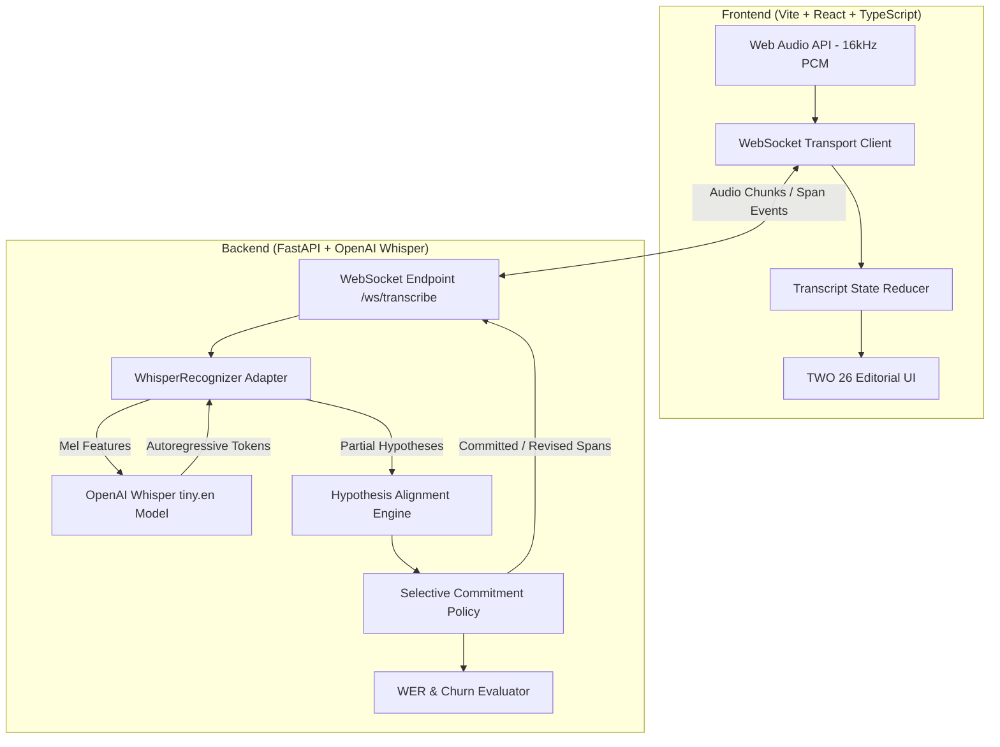

# TWO 26 • Selective Commitment Streaming Speech-to-Text (ASR)

A modern, real-time streaming speech-to-text platform featuring **Selective Commitment** to decouple provisional hypotheses from committed text, powered directly by **OpenAI Whisper** on CUDA/CPU with a **TWO 26 studio editorial aesthetic**.

---

## 🎯 The Core Concept: Selective Commitment

In conventional streaming automatic speech recognition (ASR):
- **Eager commitment** causes severe visual flicker and churn when future acoustic context changes prior tokens.
- **Utterance-level delayed commitment** introduces high latency, forcing the user to wait until pauses before seeing stable text.
- **Monotonic fixed-lag** commits blindly by word count regardless of confidence or stability.

**Selective Commitment** solves this:
1. **Provisional Spans**: Remain visibly distinct (editable, dashed amber/orange) and can be revised when new acoustic evidence arrives.
2. **Selective Commitment**: Spans lock in and turn permanent (**committed**) once they achieve stability across $K$ consecutive partial hypotheses or reach a latency deadline.
3. **Non-blocking Stream**: Downstream speech continues to be transcribed even while earlier spans remain provisional.
4. **Isolate Revisions**: Corrections update only the affected provisional token without disrupting preceding stable text.

---

## 🏗️ System Architecture



---

## 🎨 Visual Identity: TWO 26 Studio Aesthetic

The application is styled with the bold, high-contrast **TWO 26 studio editorial aesthetic**:
- **Canvas Palette**: Warm pastel peach-cream (`#faeee7`).
- **Signature Accent**: Electric warm studio orange (`#ff4800` / `#ff5500`).
- **Ink-Black Elements**: Deep charcoal (`#121212`) cards with neo-brutalist offset drop shadows (`3px 3px 0px #121212`).
- **Typography**: Ultra-bold display font (`Syne 900`) for headers and `Plus Jakarta Sans` for clean editorial UI copy.
- **Floating Stickers**: Rotated pill tags (`-6°` and `+4°`) highlighting key capabilities.
- **Accessible State Differentiation**:
  - 🟢 **Committed Spans**: Solid ink-black text with bold baseline indicator.
  - 🟡 **Provisional Spans**: Electric orange text with warm peach pillow backgrounds (`#ffebe3`) and dashed borders.
  - 🟣 **Revised Spans**: Vivid purple correction tags with micro-bounce animations (`↺1`).

---

## 🚀 Quickstart Guide

### 1. Prerequisites
- **Python 3.10+** (with NVIDIA GPU & CUDA recommended)
- **Node.js 20+** and **npm**

### 2. Backend Setup (FastAPI + Whisper)
```powershell
cd backend
python -m venv venv
venv\Scripts\activate
pip install -r requirements.txt
uvicorn app.main:app --host 0.0.0.0 --port 8000 --lifespan on
```
- **Health Check**: `http://127.0.0.1:8000/health`
- **WebSocket Streaming**: `ws://127.0.0.1:8000/ws/transcribe`
- **Replay Scorer**: `POST http://127.0.0.1:8000/api/replay`

### 3. Frontend Setup (Vite + React)
```powershell
cd frontend
npm install
npm run dev
```
Open **[http://localhost:5173/](http://localhost:5173/)** in your browser.

---

## ⚙️ Production Deployment (Systemd Services)

For Linux / AWS EC2 deployments, pre-configured systemd service unit files are located in `services/`:

```bash
# Automated installation:
sudo bash services/install-services.sh
```

Or manually:
```bash
sudo cp services/two26-backend.service /etc/systemd/system/backend.service
sudo cp services/two26-frontend.service /etc/systemd/system/frontend.service
sudo systemctl daemon-reload
sudo systemctl enable --now backend.service frontend.service
```

---

## 📁 Repository Structure

```text
├── backend/
│   ├── app/
│   │   ├── adapters/            # Recognizer adapters (WhisperRecognizer, MockRecognizer)
│   │   ├── core/                # Alignment algorithm, Policy engine, Session manager
│   │   ├── metrics/             # Levenshtein WER scorer and text normalizer
│   │   ├── models/              # Pydantic schemas (spans, events, policies)
│   │   ├── audio_processing.py  # Bandpass filtering & noise gating
│   │   └── main.py              # FastAPI server & WebSocket routes
│   ├── two26-backend.service    # Systemd service unit for backend
│   └── requirements.txt
├── frontend/
│   ├── src/
│   │   ├── audio/               # Web Audio API 16kHz PCM capture
│   │   ├── components/          # Controls, Live Transcript, Metrics Panel
│   │   ├── index.css            # TWO 26 design system tokens
│   │   └── App.tsx              # Application layout & WebSocket client
│   ├── two26-frontend.service   # Systemd service unit for frontend
│   ├── package.json
│   └── vite.config.ts
├── services/                    # Production service definitions & deployment scripts
│   ├── two26-backend.service
│   ├── two26-frontend.service
│   ├── install-services.sh
│   ├── start-services.bat
│   └── start-services.ps1
├── docker-compose.yml           # Multi-service container specification
├── plan.md                      # Engineering manifesto & requirements
└── README.md
```

---

## 📜 License
MIT License.
